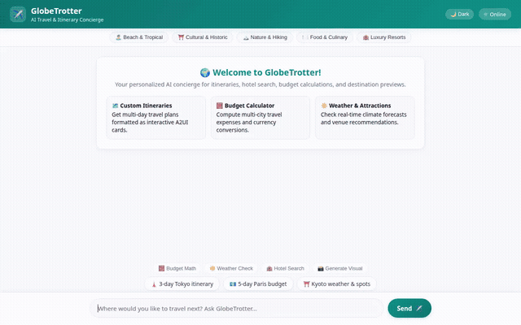

# GlobeTrotter — AI Travel & Itinerary Concierge



GlobeTrotter is an intelligent AI travel concierge built with Google's Agent Development Kit (ADK) and Gemini models. It helps travelers discover curated destinations, build personalized multi-day itineraries, generate custom destination visuals, perform budget math, and check local weather and maps—all while remembering individual dietary and travel preferences across sessions.

---

## 🚀 Features & Implemented Capabilities

GlobeTrotter is backed by Google Cloud infrastructure and Gemini generative models:

* **Conversational Travel Planning**: Powered by `gemini-2.5-flash` with structured system instructions.
* **Persistent Memory Bank**: Uses **Vertex AI Memory Bank** (`VertexAiMemoryBankService`) and `PreloadMemoryTool` to track and recall user allergies, dietary restrictions, and travel preferences across conversation turns.
* **Firestore Destination Catalog**: Connects to Google Cloud Firestore (`globetrotter-db`) to search and record curated travel destinations, hotels, and points of interest.
* **AI Image Generation**: Generates high-quality destination visuals using `gemini-3.1-flash-lite-image` in the `global` region and publishes them to Google Cloud Storage (`globetrotter-assets-380895049416`).
* **AI Video Clips**: Generates short travel videos using `gemini-omni-flash-preview` via the Google GenAI Interactions API, saving artifacts to the ADK Playground and publishing to Cloud Storage.
* **Google Maps Integration**: Geocodes destination addresses and searches nearby attractions using Google Maps Geocoding and Places APIs.
* **Sandboxed Code Execution**: Executes Python math and budget calculations securely via `AgentEngineSandboxCodeExecutor`.
* **A2UI Rich UI Cards**: Formats responses as interactive A2UI cards (v0.8 `BasicCatalog` schema) over A2A protocol.
* **Interactive Frontend**: Includes a responsive web interface with dark/light mode toggle, prompt chips, category filter pills, tool shortcuts, and image lightbox viewer.

---

## 🛠️ Implemented Agent Tools

| Tool | Purpose | Service / Model |
| --- | --- | --- |
| `search_destinations` | Searches curated destination catalog | Cloud Firestore (`globetrotter-db`) |
| `add_destination` | Saves new destinations or hotels to catalog | Cloud Firestore (`globetrotter-db`) |
| `generate_destination_image` | Generates location visual previews | `gemini-3.1-flash-lite-image` & Cloud Storage |
| `generate_destination_video` | Generates short destination video clips | `gemini-omni-flash-preview` & Cloud Storage |
| `geocode_address` | Converts locations to lat/long coordinates | Google Maps Geocoding API |
| `find_nearby_places` | Finds points of interest and landmarks nearby | Google Maps Places API |
| `calculate_trip_budget` | Estimates multi-day travel expenses | Sandboxed Code Executor |
| `get_currency_exchange_rates` | Retrieves live or estimated exchange rates | Financial calculation utility |
| `get_weather` | Retrieves weather forecasts for destinations | Weather simulation service |
| `PreloadMemoryTool` | Pre-loads stored user allergies & preferences | Vertex AI Memory Bank |

---

## 💻 Local Setup & Development

### 1. Prerequisites
- Python 3.10+
- `uv` or `pip`
- Google Cloud SDK (`gcloud`) authenticated with project access
- Set environment variable: `export GOOGLE_CLOUD_PROJECT="<your-gcp-project-id>"`

### 2. Install Agent Dependencies
From the agent project directory:
```bash
uv pip install -r requirements.txt
```

### 3. Run the Frontend Locally
Navigate to the `frontend/` directory, set environment variables, and start the proxy server:

```bash
cd frontend
pip install -r requirements.txt

export AGENT_ENGINE_RESOURCE_NAME="projects/<project-number>/locations/us-central1/reasoningEngines/<reasoning-engine-id>"
export AGENT_DIRECTORY="app"

python main.py
```

Access the chat interface in your web browser at port `8080`.

---

## ☁️ Cloud Deployment

### Deploy Agent to Vertex AI Agent Runtime / Reasoning Engine
```bash
agents-cli deploy --project <your-gcp-project-id> --region us-central1
```

### Deploy Frontend to Cloud Run
```bash
gcloud run deploy globetrotter-frontend \
  --source . \
  --region us-central1 \
  --allow-unauthenticated \
  --set-env-vars="AGENT_ENGINE_RESOURCE_NAME=$AGENT_ENGINE_RESOURCE_NAME,AGENT_DIRECTORY=$AGENT_DIRECTORY"
```

---

## 📄 License
Built with Google Agent Development Kit (ADK) & Gemini.
